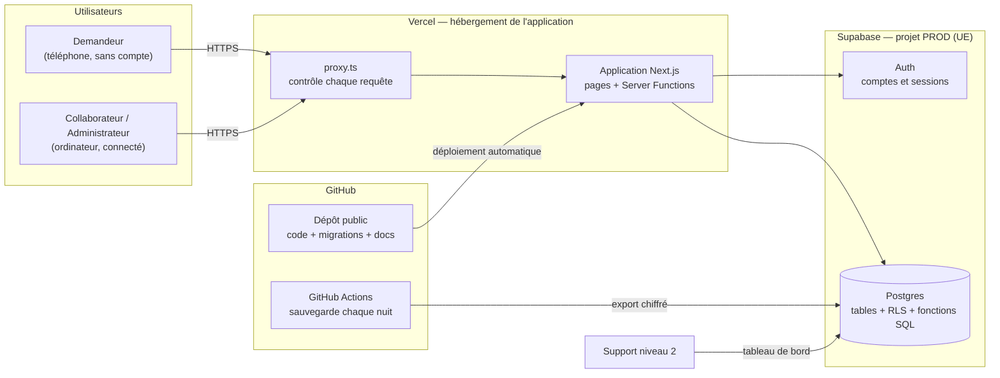
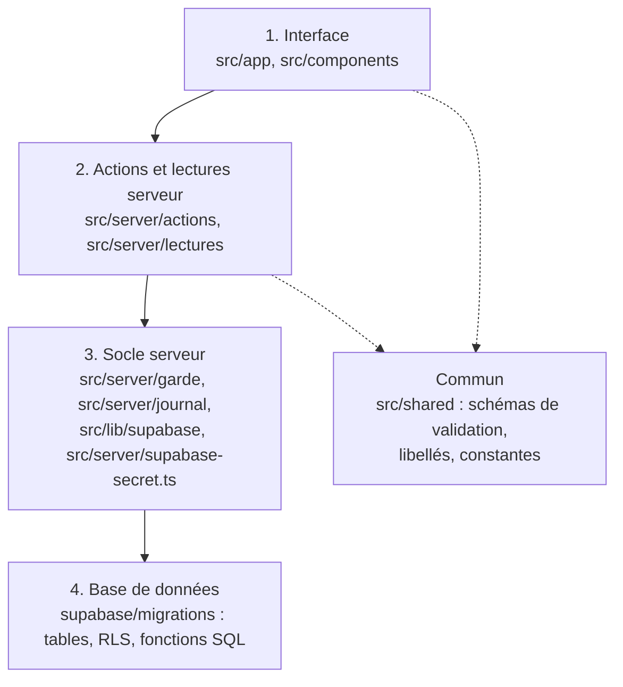
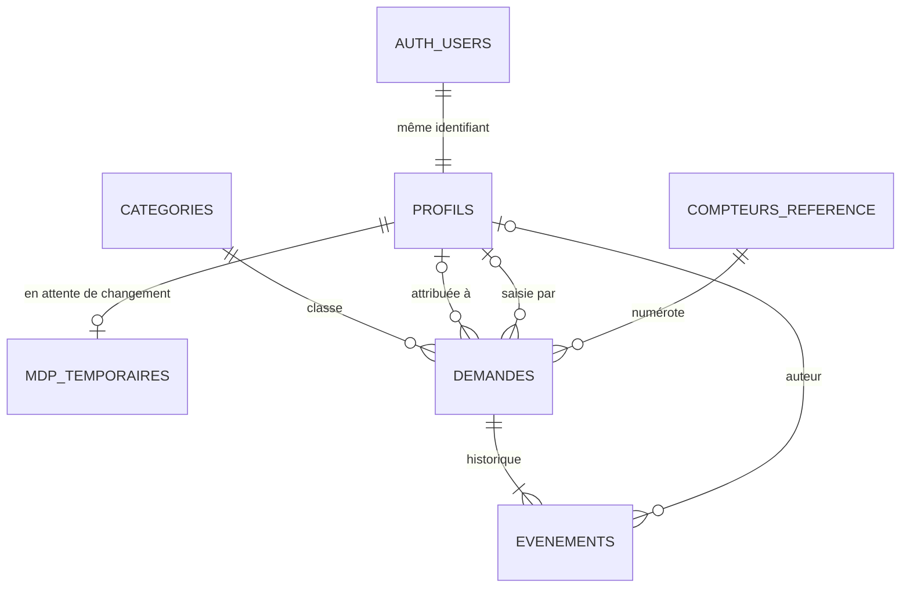
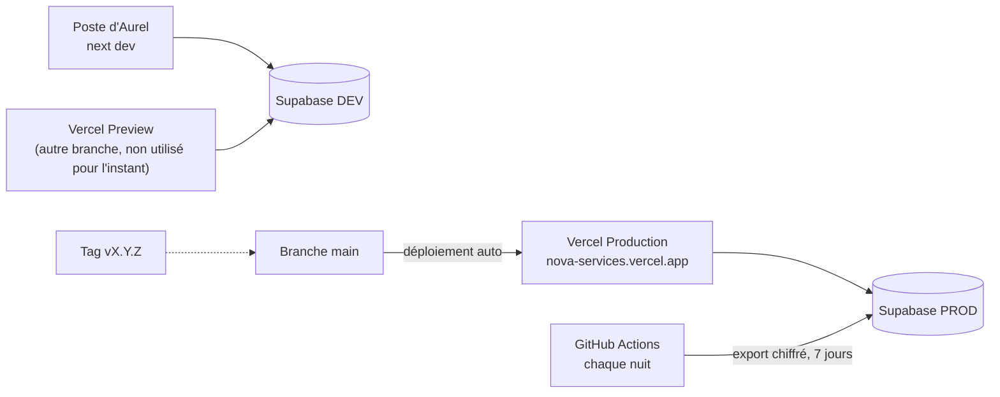

# Architecture — Nova Services

> **Ce document fixe les règles techniques communes** que tout le code devra respecter, pour que les parties construites séparément (une story après l'autre, par une personne ou une IA) restent compatibles. Il ne contient pas de code. Les **quoi** et **pour qui** sont dans le [PRD](../../prds/prd-projet-ia-2026-11-08/prd.md), l'apparence et le comportement des écrans dans [DESIGN.md](../../ux-designs/ux-projet-ia-2026-11-08/DESIGN.md) et [EXPERIENCE.md](../../ux-designs/ux-projet-ia-2026-11-08/EXPERIENCE.md).
>
> Chaque règle importante porte un numéro **AD-n** (*Architecture Decision*), qui ne changera jamais : les stories pourront le citer. Pour chacune : ce qu'elle **concerne** (*Binds*), ce qu'elle **évite** (*Prevents*) et la **règle** à suivre (*Rule*) ; les mots anglais servent aux étapes BMAD suivantes. `[ADOPTED]` signale ce qui existe déjà dans le dépôt et qu'on garde. `[HYPOTHÈSE]` signale un choix du rédacteur ; tous ont été **confirmés par Aurel le 8 novembre 2026** et sont regroupés au §11.
>
> **État :** document validé le 8 novembre 2026 (rapport : [validation-report.md](validation-report.md), 10 corrections intégrées).

**Petit lexique**

- **Stack** : l'ensemble des outils techniques utilisés (langage, cadre de travail, base de données, hébergeur).
- **Brique** : une partie de l'application qui a un rôle précis (le dépôt public, les comptes, l'historique…).
- **Serveur / navigateur** : le code « serveur » tourne chez l'hébergeur, à l'abri ; le code « navigateur » tourne sur l'ordinateur de l'utilisateur, où n'importe qui peut le lire et le modifier. **Toute vérification de sécurité se fait côté serveur.**
- **Server Function** (Next.js) : une fonction écrite dans l'application mais exécutée sur le serveur, appelée par un formulaire ou un bouton.
- **Fonction SQL** : un petit programme rangé **dans la base de données**, qui fait plusieurs opérations d'un seul bloc (une **transaction** : tout réussit, ou rien n'est enregistré).
- **RLS** (*Row Level Security*) : des règles posées dans la base, qui décident ligne par ligne qui peut lire ou modifier quoi, même si quelqu'un contourne l'application.
- **Migration** : un fichier SQL qui modifie la structure de la base (ajouter une table, une colonne). Les migrations sont rangées dans le dépôt et appliquées dans l'ordre.
- **Variable d'environnement** : un réglage (adresse, clé secrète) fourni par l'hébergeur au démarrage, jamais écrit dans le code.

---

## 1. Vue d'ensemble



## 2. Principe d'organisation (paradigme)

**Monolithe modulaire en couches** : une seule application (plus simple à héberger et à comprendre qu'un ensemble de petits services), découpée en couches qui ne dépendent que de la couche du dessous. **Le cœur des règles métier est dans la base** (fonctions SQL), pour que les règles tiennent même en cas d'actions simultanées.



Une flèche signifie « peut utiliser ». Aucune flèche ne remonte : la base ne connaît pas l'application, le socle ne connaît pas les écrans. `src/shared` ne dépend de rien et peut être utilisé partout.

## 3. Stack retenue

| Outil | Version | Rôle | Pourquoi ce choix |
|---|---|---|---|
| **Next.js** `[ADOPTED]` | 16.4.5 | Cadre de travail de l'application (pages + serveur) | Déjà installé, il gère dans un seul projet les pages, le code serveur et le contrôle d'accès, ce qui évite un serveur séparé. |
| **React** `[ADOPTED]` | 19.3.0 | Construction des écrans | Imposé par Next.js, c'est la bibliothèque d'interface la plus répandue. |
| **TypeScript** `[ADOPTED]` | 5.9.3 | Langage | Il signale les erreurs de type avant l'exécution, ce qui aide beaucoup quand le code est écrit avec une IA. La version 7 existe mais on garde la 5.9 installée, testée avec Next.js 16. |
| **Tailwind CSS** `[ADOPTED]` | 4.3 | Mise en forme | Déjà installé, il permet de traduire directement les tokens de DESIGN.md en classes. |
| **shadcn/ui** `[HYPOTHÈSE]` | CLI 4.23 | Composants d'interface (fenêtres, listes, toasts…) | Il copie dans le projet des composants accessibles au clavier et aux lecteurs d'écran, qu'on habille avec nos tokens, au lieu de les coder soi-même. |
| **lucide-react** | 1.70 | Icônes | C'est la famille d'icônes au trait choisie dans DESIGN.md (D-H9), et celle utilisée par shadcn/ui. |
| **Zod** | 4.6 | Vérification des saisies | Un seul schéma par formulaire, utilisé à la fois dans le navigateur (messages immédiats) et sur le serveur (vérification qui fait foi). |
| **Supabase** (Postgres 17 + Auth) `[ADOPTED]` | `@supabase/supabase-js` 2.118, `@supabase/ssr` 0.12.7 | Base de données, comptes, sessions | Déjà installé, gratuit, il fournit une vraie base Postgres et la gestion des mots de passe hachés (NFR-11) sans serveur à administrer. |
| **Supabase CLI** | 3.0 | Migrations et export de la base | Outil officiel pour appliquer les migrations versionnées et faire les sauvegardes recommandées sur l'offre gratuite. |
| **Vitest** | 5.1 | Tests automatisés des règles métier | Rapide et simple à configurer avec TypeScript, il couvre les règles RM-1 à RM-14 exigées par NFR-14. |
| **Playwright** | 1.65 | Test de bout en bout du parcours principal | Il pilote un vrai navigateur pour rejouer SM-1 (dépôt → traitement) avant chaque mise en production. |
| **Node.js** `[HYPOTHÈSE]` | 24.x (LTS) | Moteur qui exécute le code serveur | Version stable à long terme proposée par Vercel. |
| **Vercel** (offre Hobby) | — | Hébergement de l'application | Fait par les créateurs de Next.js : mise en ligne à chaque envoi sur GitHub, HTTPS inclus, retour arrière en un clic, gratuit (décision d'Aurel). |
| **GitHub Actions** | — | Sauvegarde automatique chaque nuit | Gratuit pour un dépôt public, il remplace les sauvegardes absentes de l'offre gratuite de Supabase (décision d'Aurel). |

Versions relevées sur le registre npm et dans le dépôt le 8 novembre 2026.

## 4. Découpage en briques

| # | Brique | Ce qu'elle fait | Écrans (UX) | Exigences |
|---|---|---|---|---|
| **B1** | Dépôt public | Formulaire sans compte, anti-spam, enregistrement, confirmation avec référence. | P1, P2 | FR-1 à FR-6 |
| **B2** | Comptes et session | Connexion, blocage après 5 échecs, premier mot de passe, déconnexion, expiration après 8 h, fin de session d'un compte désactivé. | I1, I2 | FR-8 à FR-10, FR-21, FR-23 |
| **B3** | Liste des demandes | Liste paginée, recherche, filtres, compteur « à traiter », mention « Sans activité ». Tenue du temps de réponse : moins de 2 secondes avec 5 000 demandes, grâce à une seule fonction de lecture paginée et à des index sur la date de dépôt, le statut, la catégorie et le texte de recherche, vérifiée par un test sur dev avec 5 000 demandes générées. | I3, pastille du menu | FR-11 à FR-14, NFR-13 |
| **B4** | Traitement d'une demande | Détail, changement de statut, attribution, priorité, commentaires, historique. | I4 | FR-15 à FR-20 |
| **B5** | Saisie interne | Création d'une demande reçue par téléphone ou par email. | I5 | FR-30 |
| **B6** | Administration | Comptes et rôles, dernier administrateur, catégories, informations générales. | A1, A2, A3 | FR-21 à FR-27, FR-31 |
| **B7** | Données personnelles | Suppression d'une demande, anonymisation des demandes anciennes. | I4 (zone admin), A4 | FR-28, FR-29 |
| **B8** | Journal technique | Enregistrement des événements importants et des erreurs, consultable par le support. | — (tableau de bord Supabase) | NFR-6 |
| **B9** | Socle commun | Thème visuel, composants, validation, format des erreurs, garde d'accès, pages S1 à S3. | S1, S2, S3, menu | FR-24, NFR-11, NFR-12 |
| **B10** | Exploitation | Environnements, migrations, mise en production, retour arrière, sauvegardes, documentation. | — | NFR-1 à NFR-5, NFR-7 à NFR-10, NFR-14 |

## 5. Données principales et leurs liens



| Table | Contient | Points clés |
|---|---|---|
| `auth.users` (Supabase) | Email et mot de passe haché | Gérée par Supabase Auth ; on n'y écrit jamais directement. |
| `profils` | Nom, email, rôle (`collaborateur` ou `administrateur`), actif oui/non, « doit changer son mot de passe » | Un profil par compte, même identifiant que `auth.users`. **Le rôle est lu ici, nulle part ailleurs** (AD-7). Jamais supprimé (RM-10). |
| `mdp_temporaires` | Empreinte du mot de passe temporaire | Sert seulement à refuser sa réutilisation (FR-21), effacée dès le nouveau mot de passe choisi. Illisible par l'application. |
| `categories` | Nom, active oui/non | Deux catégories actives ne peuvent pas porter le même nom. |
| `demandes` | Référence, coordonnées, objet, description, catégorie, canal, statut, priorité, attribution, dates (dépôt, clôture, dernière activité, anonymisation) | La référence ne change jamais (RM-2). Statut, priorité et canal sont des listes fermées. |
| `evenements` | Type, auteur (profil, ou libellé « Demandeur » / « Système »), ancien et nouveau statut, texte du commentaire, date | L'historique (FR-17). Ajout seulement (AD-3). Supprimé avec sa demande (FR-28). |
| `compteurs_reference` | Année, dernier numéro attribué | Garantit des références uniques sans trou de logique (AD-4). |
| `parametres` | Téléphone, email de contact, contact données personnelles | Une seule ligne (FR-31). |
| `journal_technique` | Date, niveau (`info`, `avertissement`, `erreur`), événement, détails, code d'erreur | Jamais de mot de passe ni de texte saisi par un demandeur (AD-12). |
| `tentatives_connexion` | Email, date, réussite | Sert au blocage après 5 échecs (FR-8). Purgée après 24 h. |
| `envois_formulaire` | Empreinte de l'adresse IP, date | Sert à la limite de 10 envois par heure (FR-6). Purgée après 24 h. |

Les noms exacts des colonnes et les index sont laissés au code (premières migrations).

## 6. Règles communes

### 6.1 Organisation du code

#### AD-1 — Le navigateur ne parle jamais directement à la base

- **Concerne (Binds) :** toutes les briques.
- **Évite (Prevents) :** qu'une partie du code écrive dans la base depuis le navigateur, où les contrôles peuvent être contournés.
- **Règle (Rule) :** toute lecture passe par un Server Component ou une lecture de `src/server/lectures`, toute écriture par une Server Function de `src/server/actions`. Un Client Component n'importe de `src/server` que des Server Functions. Le client navigateur `src/lib/supabase/client.ts` `[ADOPTED]` n'est pas utilisé pour les données en v1.

#### AD-2 — Toute modification d'une demande passe par une fonction SQL unique

- **Concerne (Binds) :** B1, B4, B5, B7 · FR-3, FR-16 à FR-20, FR-28 à FR-30 · RM-1, RM-4, RM-5.
- **Évite (Prevents) :** une modification sans ligne d'historique, ou deux façons différentes de changer un statut.
- **Règle (Rule) :** l'application ne fait **jamais** d'`insert`, `update` ou `delete` direct sur `demandes` ou `evenements`. Elle appelle l'une de ces fonctions SQL, et seulement elles : `deposer_demande`, `saisir_demande`, `changer_statut`, `attribuer_demande`, `changer_priorite`, `ajouter_commentaire`, `supprimer_demande`, `anonymiser_demandes`. Chacune vérifie l'utilisateur et ses droits, verrouille la demande, applique la règle, écrit l'événement d'historique et met à jour la « dernière activité », **dans la même transaction**. Les tables n'ont aucune règle RLS d'écriture : ces fonctions sont le seul chemin possible.

#### AD-3 — L'historique ne se modifie pas

- **Concerne (Binds) :** B4, B7 · FR-17, FR-20 · RM-5.
- **Évite (Prevents) :** un historique retouché, donc non fiable.
- **Règle (Rule) :** personne ne peut modifier ou supprimer une ligne de `evenements`, administrateur compris. Seules deux exceptions existent, uniquement dans leur fonction SQL : `supprimer_demande` efface la demande avec son historique, et `anonymiser_demandes` remplace le texte des commentaires par « [anonymisé] ».

#### AD-4 — La référence est attribuée par la base

- **Concerne (Binds) :** B1, B5 · FR-3 · RM-2.
- **Évite (Prevents) :** deux demandes avec la même référence quand deux envois arrivent au même instant.
- **Règle (Rule) :** la référence `NOVA-AAAA-NNNN` est calculée dans `deposer_demande` et `saisir_demande`, à partir de `compteurs_reference`, verrouillé pendant la transaction. Le numéro a au moins 4 chiffres et repart à 1 chaque année. L'application ne la calcule jamais et ne la modifie jamais.

#### AD-5 — Statuts et transitions : une seule source de vérité

- **Concerne (Binds) :** B3, B4 · FR-14, FR-16 · RM-3, RM-4.
- **Évite (Prevents) :** un écran qui propose un passage que la base refuse, ou l'inverse ; un compteur qui ne compte pas comme le filtre.
- **Règle (Rule) :**
  - les transitions permises (FR-16) sont vérifiées par `changer_statut`. La constante `TRANSITIONS_STATUT` de `src/shared` sert seulement à afficher les boutons, et un test vérifie qu'elle donne les mêmes réponses que la fonction ;
  - `changer_statut` reçoit le statut **que l'utilisateur avait sous les yeux**. S'il a changé entre-temps, la fonction applique le passage seulement s'il reste permis depuis le statut réel, enregistre ce statut réel comme « ancien statut », et renvoie qui l'a modifié et quand (message « modifiée entre-temps » de l'UX). Choisir le statut déjà en place ne crée rien ;
  - la définition des **demandes à traiter** (*Nouvelle*, ou *Urgente* non *Traitée*) et de **sans activité** (*En cours* depuis plus de 7 jours) existe **une seule fois**, dans la base. Le compteur et le filtre « À traiter » l'utilisent tous les deux.

### 6.2 Comptes et sessions

#### AD-6 — Comptes créés uniquement par un administrateur

- **Concerne (Binds) :** B2, B6 · FR-21 à FR-23 · RM-8, RM-10.
- **Évite (Prevents) :** une inscription publique, ou un compte créé sans passer par les règles du PRD.
- **Règle (Rule) :**
  - **inscriptions publiques désactivées** dans Supabase Auth ; longueur minimale du mot de passe réglée à 12 ;
  - création, réinitialisation, désactivation et réactivation passent par `src/server/admin`, qui utilise l'API d'administration de Supabase. Le compte est créé « email confirmé », donc sans aucun email ;
  - **une seule façon de créer un compte**, en deux temps : `src/server/admin` crée le compte dans Supabase Auth, puis appelle aussitôt la fonction SQL `creer_profil` (nom, email, rôle). Si celle-ci échoue, le compte Supabase est supprimé, pour qu'il n'existe jamais de compte sans profil. Aucun déclencheur automatique sur `auth.users` ;
  - à la création et à la réinitialisation : `doit_changer_mdp = vrai` et empreinte du mot de passe temporaire dans `mdp_temporaires`. Le nouveau mot de passe est refusé s'il est identique ;
  - désactiver = `actif = faux` dans `profils` **et** blocage du compte dans Supabase Auth, pour que sa session ne puisse plus se renouveler. Un compte n'est jamais supprimé.

#### AD-7 — Garde d'accès : vérifiée à chaque requête et à chaque action

- **Concerne (Binds) :** toutes les briques internes · FR-9, FR-10, FR-21, FR-22, FR-24.
- **Évite (Prevents) :** qu'un compte désactivé ou rétrogradé garde ses droits jusqu'à la fin de sa session, ou qu'une page oublie le contrôle.
- **Règle (Rule) :**
  - `src/proxy.ts` `[ADOPTED]` s'exécute à chaque requête : il rafraîchit la session, renvoie vers la connexion toute page interne sans session, envoie vers I2 tant que `doit_changer_mdp` est vrai, déconnecte un compte inactif (`actif = faux`) avec le message de l'UX, applique l'**expiration après 8 h d'inactivité**, et interdit la mise en cache des pages internes ;
  - l'expiration des 8 h est gérée par l'application (cookie serveur de dernière activité), car l'option de Supabase est réservée à l'offre payante ;
  - **chaque** Server Function et chaque lecture interne commence par `exigerUtilisateur()` ou `exigerAdministrateur()` (`src/server/garde`), qui relit le profil (actif, rôle) dans la base. Les fonctions SQL refont le même contrôle de leur côté ;
  - **le rôle vient toujours de la table `profils`**, jamais des métadonnées du compte Supabase, que l'utilisateur peut modifier lui-même.

#### AD-8 — Blocage des connexions et messages neutres

- **Concerne (Binds) :** B2 · FR-8.
- **Évite (Prevents) :** qu'un message révèle si un email a un compte, ou qu'on essaie des mots de passe sans limite.
- **Règle (Rule) :** la Server Function de connexion compte les échecs récents de l'email dans `tentatives_connexion` **avant** d'appeler Supabase : 5 échecs en 15 minutes bloquent. Les seuls messages possibles sont « Identifiants incorrects » et « Trop de tentatives, réessayez plus tard », que le compte existe ou non.

### 6.3 Droits d'accès

#### AD-9 — Double barrière : l'application et la base

- **Concerne (Binds) :** toutes les briques · FR-10, FR-24 · NFR-11 · RM-6, RM-7.
- **Évite (Prevents) :** qu'un bouton caché soit la seule protection, ou qu'un appel direct à la base contourne l'application.
- **Règle (Rule) :**
  - RLS activé sur **toutes** les tables : rien n'est permis sauf ce qui est écrit. Les utilisateurs internes actifs lisent les demandes, catégories, événements, paramètres et profils (pour afficher les noms et proposer l'attribution). Seuls les administrateurs voient les profils désactivés dans la gestion des comptes. Aucune table n'est lisible par l'application : `mdp_temporaires`, `tentatives_connexion`, `envois_formulaire`, `journal_technique`, `compteurs_reference` ;
  - **personne n'écrit directement dans une table**. Chaque écriture passe par une fonction SQL nommée : celles d'AD-2 pour les demandes, `creer_profil` et `modifier_compte` pour les comptes, `ajouter_categorie` et `modifier_categorie` pour les catégories, `modifier_parametres`, `enregistrer_tentative`, `ecrire_journal` ;
  - **protection des fonctions SQL** : chaque fonction s'exécute avec les droits de son propriétaire (`security definer`), avec un chemin de recherche vide (`set search_path = ''`, protection contre une attaque connue de Postgres), et commence par vérifier qui l'appelle. Le droit de la lancer est d'abord retiré à tout le monde (`revoke execute … from public`), puis donné explicitement, soit au rôle `authenticated` (fonctions internes : statut, attribution, priorité, commentaire, saisie, catégories, paramètres, suppression, anonymisation), soit au seul rôle `service_role` (dépôt, connexion, journal, comptes). Chaque migration qui crée une fonction contient ses droits ;
  - le rôle public de Supabase (`anon`) n'a **aucun droit**. La clé publique étant visible dans le navigateur, le dépôt public passe par une Server Function de `src/server/depot`, qui appelle `deposer_demande` avec la clé secrète ;
  - la **clé secrète** n'existe que dans `src/server/supabase-secret.ts`, marqué « serveur uniquement ». Seuls quatre modules peuvent l'importer, ce que vérifie une règle ESLint : `src/server/admin` (comptes), `src/server/depot` (formulaire public), `src/server/connexion` (tentatives de connexion, avant que l'utilisateur soit connecté) et `src/server/journal` (le journal reçoit aussi des événements de personnes non connectées). Plus les tâches d'exploitation ;
  - un collaborateur qui force une adresse d'administration voit S1 ; une action réservée est refusée par `exigerAdministrateur()` **et** par la fonction SQL.

#### AD-10 — Règles « il en reste toujours un » gardées par la base

- **Concerne (Binds) :** B6 · FR-25, FR-26 · RM-9, RM-11.
- **Évite (Prevents) :** que deux administrateurs qui agissent au même instant suppriment le dernier administrateur ou la dernière catégorie active.
- **Règle (Rule) :** changement de rôle et désactivation d'un compte passent par la fonction SQL `modifier_compte`. Désactivation et suppression d'une catégorie passent par `modifier_categorie`. Chacune verrouille les lignes concernées, compte ce qui reste, et refuse avec le message exact du PRD s'il ne resterait aucun administrateur actif ou aucune catégorie active.

### 6.4 Saisies et erreurs

#### AD-11 — Une seule définition de chaque formulaire

- **Concerne (Binds) :** B1, B2, B5, B6 · FR-1, FR-2, FR-5, FR-30, FR-31.
- **Évite (Prevents) :** des limites ou des messages différents entre le navigateur, le serveur et la base.
- **Règle (Rule) :** chaque formulaire a **un** schéma Zod dans `src/shared/schemas`, avec les limites du PRD et les messages exacts de l'UX. Le navigateur l'utilise pour les messages immédiats, la Server Function pour la vérification qui fait foi. La base ajoute les mêmes limites en dernière barrière. Tout le texte saisi est affiché comme du texte simple, jamais interprété comme du code (NFR-11).

#### AD-12 — Un seul format de réponse et d'erreur

- **Concerne (Binds) :** toutes les briques · FR-2, FR-4 · NFR-6, NFR-9.
- **Évite (Prevents) :** que chaque écran invente sa façon de signaler une erreur, ou qu'un détail technique s'affiche.
- **Règle (Rule) :**
  - chaque Server Function renvoie soit `{ ok: true, donnees }`, soit `{ ok: false, code, message, champs? }`. Une erreur **prévue** (saisie, droits, conflit) ne lève jamais d'exception ;
  - les codes forment une liste fermée : `VALIDATION`, `NON_CONNECTE`, `ACCES_REFUSE`, `INTROUVABLE`, `CONFLIT`, `TROP_DE_TENTATIVES`, `LIMITE_ENVOIS`, `ERREUR_INTERNE` ;
  - une erreur **imprévue** est attrapée par une enveloppe commune à toutes les Server Functions. Elle l'écrit dans `journal_technique` avec un code court (par exemple `7F3A`) et renvoie `ERREUR_INTERNE` avec ce code. Côté pages, les écrans d'erreur de Next.js affichent S3 avec le code, l'heure et la page (NFR-9) ;
  - une erreur qui survient **pendant l'affichage d'une page** (et non dans une action) est enregistrée par la fonction `onRequestError` de `src/instrumentation.ts`, le point d'entrée prévu par Next.js pour les erreurs serveur. Elle l'écrit dans `journal_technique` avec le code fourni par Next.js (`digest`), que S3 affiche ;
  - les messages affichés sont ceux d'EXPERIENCE.md, en français, sans détail technique.

### 6.5 Données personnelles et journal

#### AD-13 — Le journal technique ne contient pas de données des demandeurs

- **Concerne (Binds) :** B8 et tout le code serveur · NFR-6 · FR-22, FR-28, FR-29.
- **Évite (Prevents) :** des journaux éparpillés, ou qui contiennent des données personnelles.
- **Règle (Rule) :** on écrit dans le journal **uniquement** par `journaliser(niveau, evenement, details)` (`src/server/journal`). La liste des événements est fermée : `connexion_reussie`, `connexion_echouee`, `connexion_bloquee`, `compte_cree`, `role_modifie`, `compte_desactive`, `compte_reactive`, `mot_de_passe_reinitialise`, `demande_supprimee`, `anonymisation`, `parametres_modifies`, `envoi_refuse`, `erreur_inattendue`, `sauvegarde_reussie`. Les détails peuvent contenir une référence, l'identifiant ou l'email d'un **utilisateur interne**, un code d'erreur. **Jamais** de mot de passe, ni de nom, coordonnées ou texte d'un demandeur. Le support de niveau 2 le consulte et le filtre dans le tableau de bord de Supabase.

#### AD-14 — Anti-spam sans garder les adresses IP

- **Concerne (Binds) :** B1 · FR-6 · RGPD.
- **Évite (Prevents) :** de stocker des adresses IP en clair, qui sont des données personnelles.
- **Règle (Rule) :** l'adresse IP est lue à un seul endroit : la première valeur de l'en-tête `x-forwarded-for` transmis par Vercel. Elle est transformée en empreinte (calcul à sens unique, avec un secret) avant d'être enregistrée dans `envois_formulaire`. Au-delà de 10 envois par heure, l'envoi est refusé (`LIMITE_ENVOIS`). Un formulaire qui remplit le champ caché est ignoré sans rien enregistrer. Les lignes de plus de 24 h sont effacées.

### 6.6 Exploitation

#### AD-15 — Deux environnements séparés, aucun secret dans le dépôt

- **Concerne (Binds) :** B10 · NFR-2, NFR-3.
- **Évite (Prevents) :** qu'une donnée de test arrive en production, ou qu'une clé fuite dans le dépôt public.
- **Règle (Rule) :**
  - deux projets Supabase, **dev** et **prod**, dans l'Union européenne. Le poste local et les prévisualisations Vercel utilisent **dev** ; seule la production Vercel (branche `main`) utilise **prod** ;
  - toutes les clés sont des variables d'environnement. `.env.example` les liste avec des valeurs fictives : `NEXT_PUBLIC_SUPABASE_URL`, `NEXT_PUBLIC_SUPABASE_PUBLISHABLE_KEY` `[ADOPTED]`, `SUPABASE_SECRET_KEY`, `SECRET_EMPREINTE_IP`, `SECRET_COOKIES` (signature des cookies d'AD-20) ;
  - une variable `NEXT_PUBLIC_` est visible par tous : aucune clé secrète ne porte ce préfixe ;
  - un outil de détection de secrets (gitleaks) analyse le dépôt avant chaque mise en production.

#### AD-16 — La structure de la base ne change que par migration

- **Concerne (Binds) :** B10 et toutes les briques · NFR-5.
- **Évite (Prevents) :** une base de production différente de celle du code, et un retour arrière impossible.
- **Règle (Rule) :** tables, RLS et fonctions SQL n'existent que dans `supabase/migrations/`. Une migration est appliquée d'abord sur **dev**, puis sur **prod** avec la Supabase CLI ; jamais de modification à la main dans le tableau de bord de prod. Une migration doit rester compatible avec la version précédente de l'application (on ajoute d'abord, on retire seulement dans une version suivante). C'est ce qui rend possible le retour arrière de Vercel.

#### AD-17 — Mise en production, version et retour arrière

- **Concerne (Binds) :** B10 · NFR-4, NFR-5, NFR-14.
- **Évite (Prevents) :** de ne pas savoir quelle version tourne, ou de ne pas pouvoir revenir en arrière.
- **Règle (Rule) :** la production correspond à la branche `main`. Chaque mise en production porte un tag Git `vX.Y.Z`, identique à la version de `package.json`, affichée dans le menu de l'espace interne. Avant le tag, les tests Vitest et Playwright passent sur **dev**. En cas de problème : « Instant Rollback » de Vercel vers la version précédente (seule possibilité de l'offre gratuite). Si une migration est en cause, la procédure écrite dans `docs/` s'applique.

#### AD-18 — Sauvegarde chiffrée chaque nuit

- **Concerne (Binds) :** B10 · NFR-7.
- **Évite (Prevents) :** de perdre plus de 24 h de données, ou de publier des données personnelles dans le dépôt public.
- **Règle (Rule) :** une tâche GitHub Actions planifiée chaque nuit exporte la base **prod** (Supabase CLI), **chiffre** le fichier avec un mot de passe stocké dans les secrets GitHub, et le garde 7 jours comme artefact. Un export non chiffré n'est jamais publié, ni dans le dépôt, ni dans un artefact. La restauration est testée au moins une fois sur **dev** (SM-4). De plus :
  - chaque sauvegarde réussie écrit `sauvegarde_reussie` dans `journal_technique` ;
  - GitHub met en pause les tâches planifiées d'un dépôt public resté 60 jours sans activité, sans prévenir. La documentation *Maintenance* demande donc de vérifier **chaque mois** que la dernière `sauvegarde_reussie` date de moins de 24 h, et de réactiver la tâche si besoin ;
  - le mot de passe de chiffrement est gardé **aussi hors de GitHub** (gestionnaire de mots de passe), sinon les sauvegardes deviendraient illisibles en cas de perte d'accès au compte.

#### AD-19 — Le thème vient de DESIGN.md

- **Concerne (Binds) :** B9 et tous les écrans.
- **Évite (Prevents) :** des couleurs, coins ou tailles qui s'écartent de l'UX validée selon la page.
- **Règle (Rule) :** les tokens de DESIGN.md sont déclarés une seule fois dans `src/app/globals.css` (bloc `@theme` de Tailwind 4) et utilisés par les composants shadcn/ui. Aucune couleur écrite en dur dans un composant. Les icônes viennent uniquement de lucide-react.

### 6.7 Passage d'une page à l'autre

#### AD-20 — Rien de personnel dans l'adresse, aucun double envoi

- **Concerne (Binds) :** B1, B4, B5, B6, B9 · FR-4, FR-30 · RGPD.
- **Évite (Prevents) :** que la page de confirmation montre la demande d'un autre (les références se suivent, donc se devinent), et qu'un envoi parti deux fois crée deux demandes.
- **Règle (Rule) :**
  - les informations transmises d'une page à la suivante (contenu de la confirmation P2, petit message après une redirection, comme « Demande NOVA-2026-0036 supprimée ») voyagent dans un **cookie serveur signé**, illisible et non modifiable par le navigateur, valable 30 minutes. **Jamais** dans l'adresse de la page. Un seul module s'en occupe : `src/server/passage` ;
  - P2 lit ce cookie : actualiser la page réaffiche la même référence. Sans cookie valable, retour au formulaire P1 (comme prévu dans l'UX) ;
  - chaque formulaire de création (P1, I5) porte un **numéro d'envoi unique** tiré au hasard à l'affichage. `deposer_demande` et `saisir_demande` l'enregistrent, et un second envoi avec le même numéro renvoie la demande déjà créée au lieu d'en créer une autre.

## 7. Conventions communes

| Sujet | Convention |
|---|---|
| Langue des noms | Termes métier **en français**, comme dans le glossaire du PRD : `demandes`, `categories`, `profils`, `evenements`. Sans accents dans le code et la base. |
| Écriture des noms | Base : `snake_case` (`date_cloture`). TypeScript : `camelCase` pour les variables et fonctions, `PascalCase` pour les composants. Fichiers : `kebab-case.ts`. |
| Valeurs fermées | `nouvelle`, `en_cours`, `traitee` · `normale`, `urgente` · `formulaire`, `telephone`, `email` · `collaborateur`, `administrateur`. Le texte affiché vient d'un seul fichier : `src/shared/libelles.ts`. |
| Identifiants | UUID pour toutes les tables. La référence `NOVA-AAAA-NNNN` sert à l'affichage et dans l'adresse de la page de détail. |
| Dates | Enregistrées avec fuseau (`timestamptz`, en UTC). Affichées en heure de Paris, au format de l'UX : « 8 nov. 2026, 9 h 12 ». |
| Recherche | Insensible aux majuscules et aux accents, grâce à l'extension Postgres `unaccent`, dans une seule fonction de lecture qui renvoie à la fois la page de résultats et le nombre total. |
| Adresse de la liste | Paramètres fixes : `q`, `statut`, `categorie`, `canal`, `priorite`, `attribution`, `sans_activite`, `a_traiter`, `page`. Valeurs : les codes des valeurs fermées pour `statut`, `canal` et `priorite` ; l'**identifiant** (UUID) pour `categorie` et `attribution`, qui accepte aussi `moi` et `aucune` ; `oui` pour `sans_activite` et `a_traiter`. Tri : plus récentes d'abord. Pages de 25. |
| Types d'événements d'historique | Liste fermée : `creation`, `statut`, `attribution`, `priorite`, `commentaire`, `anonymisation`. Le texte affiché (« Statut : Nouvelle → En cours ») est construit à l'affichage à partir de ces données. |
| Performance | Toute liste passe par une fonction de lecture paginée ; jamais de chargement de toutes les demandes dans l'application. Les index sont créés dans les migrations (NFR-13). |
| Mise à jour après une action | La Server Function demande à Next.js de recalculer les pages concernées (liste, détail, compteur). Pas de cache partagé de pages qui contiennent des données personnelles. |
| Tests | `*.test.ts` à côté du code testé ; tests des règles métier dans `tests/regles/`, un fichier par règle RM. Les tests tournent sur **dev**, jamais sur prod. |
| Commits | Messages en français, au format `type: description` (`feat`, `fix`, `docs`, `test`, `chore`), directement sur `main`. |

## 8. Hébergement, environnements et coût



| Service | Offre | Coût au démarrage | Ce qui est inclus et suffit | Ce qui ferait payer plus tard |
|---|---|---|---|---|
| Vercel | Hobby | **0 €** | HTTPS, adresse `*.vercel.app`, déploiement automatique, retour à la version précédente | Usage commercial réel : offre Pro, 20 $ par mois |
| Supabase (dev + prod) | Free, 2 projets | **0 €** | 500 Mo de données par projet (le volume prévu en occupe quelques Mo par an), comptes, RLS | Plus de 500 Mo ou sauvegardes gérées : offre Pro, 25 $ par mois |
| GitHub | Dépôt public | **0 €** | Code, GitHub Actions gratuit pour un dépôt public | — |
| Nom de domaine | Aucun | **0 €** | — | Envoi d'e-mails (FR-7, FR-32) : environ 10 à 15 € par an |
| **Total** | | **0 €** | Les 2 € du budget restent en réserve. | |

**Limites de l'offre gratuite à connaître :**

- **Pause de Supabase :** un projet gratuit sans activité pendant 7 jours est mis en pause. En production, l'usage quotidien et la sauvegarde de nuit l'évitent. Le projet **dev** peut se mettre en pause : il suffit de le relancer depuis le tableau de bord.
- **Journaux de Vercel :** ils ne sont gardés qu'une heure. C'est pourquoi le journal technique est une table de la base (AD-13).
- **Retour arrière :** Vercel gratuit ne permet de revenir qu'à **la** version précédente. Pour revenir plus loin, on redéploie un ancien tag.

## 9. Arborescence de départ

```text
projet-ia/
  src/
    proxy.ts                 # garde de chaque requête (AD-7) [ADOPTED]
    instrumentation.ts       # erreurs pendant l'affichage des pages → journal (AD-12)
    app/
      (public)/              # P1 formulaire, P2 confirmation
      connexion/             # I1, I2
      (interne)/             # I3 liste, I4 détail, I5 saisie, admin/ (A1 à A4)
      globals.css            # tokens de DESIGN.md (AD-19)
    components/
      ui/                    # composants shadcn/ui
    server/
      actions/               # Server Functions, une par action (AD-1, AD-12)
      lectures/              # lectures pour les pages internes
      depot/                 # dépôt public (clé secrète, AD-9)
      admin/                 # comptes (clé secrète, AD-6)
      connexion/             # connexion, blocage après 5 échecs (clé secrète, AD-8)
      garde/                 # exigerUtilisateur, exigerAdministrateur (AD-7)
      journal/               # journaliser (AD-13)
      passage/               # cookie signé entre deux pages (AD-20)
      supabase-secret.ts     # seul client avec la clé secrète (AD-9)
    lib/supabase/            # clients avec la clé publique [ADOPTED]
    shared/
      schemas/               # schémas Zod (AD-11)
      libelles.ts            # textes des valeurs fermées
      constantes.ts          # limites, transitions de statut (AD-5)
  supabase/
    migrations/              # tables, RLS, fonctions SQL (AD-2, AD-16)
  tests/
    regles/                  # un test par règle RM-1 à RM-14
    e2e/                     # parcours SM-1 (Playwright)
  docs/
    deploiement.md  maintenance.md  support.md  securite-acces.md  donnees-personnelles.md
  .github/workflows/         # sauvegarde de nuit (AD-18), vérifications
  .env.example               # noms des variables, valeurs fictives (AD-15)
```

## 10. Reporté (décidé plus tard, volontairement)

| Sujet | Pourquoi ça peut attendre |
|---|---|
| E-mails FR-7, FR-32 et « mot de passe oublié » (Could) | Ils demandent un nom de domaine (décision d'Aurel : pas en v1). On ajoutera alors un service d'envoi gratuit, sans toucher aux règles ci-dessus. |
| Anonymisation automatique (Could) | La fonction `anonymiser_demandes` existe dès le Should ; l'appeler chaque nuit depuis GitHub Actions est un ajout simple. |
| Service de suivi des erreurs (Sentry) | Le journal en base suffit au volume prévu (décision d'Aurel). |
| Noms exacts des colonnes, index, texte SQL des règles RLS | Décidés dans les premières migrations ; ils ne changent aucune règle. |
| Durée de conservation du journal technique | À fixer dans la documentation « Données personnelles ». Proposition : 12 mois, purge par la tâche de nuit. |
| Affichage en cartes de la liste sur téléphone | Détail d'interface (EXPERIENCE.md, E-H10), sans effet sur l'architecture. |
| Rôles réels du support niveaux 1 et 2 (question ouverte n°3 du PRD) | À préciser dans la documentation *Support*. |

## 11. Hypothèses

Toutes **confirmées par Aurel le 8 novembre 2026** (A-H12 était déjà sa consigne).

| # | Hypothèse | Pourquoi |
|---|---|---|
| A-H1 | Composants shadcn/ui. | Accessibles, compatibles Tailwind 4 et React 19 (vérifié), et évitent de coder soi-même fenêtres et menus. |
| A-H2 | Projets Supabase et fonctions Vercel en Europe (région de Paris ou de Francfort). | Données personnelles de clients français (RGPD), et rapidité entre l'application et la base. |
| A-H3 | Node.js 24 (LTS). | Version stable à long terme proposée par Vercel. |
| A-H4 | Tests sur le projet Supabase **dev**, sans installer Docker sur le poste. | Docker est lourd à installer pour un débutant sur Windows ; l'offre gratuite permet justement 2 projets. |
| A-H5 | Expiration après 8 h gérée par un cookie serveur. | L'option équivalente de Supabase est payante. |
| A-H6 | Empreinte du mot de passe temporaire gardée jusqu'au changement. | Seul moyen de refuser sa réutilisation (FR-21). |
| A-H7 | Empreintes d'IP et tentatives de connexion effacées après 24 h. | Le moins de données personnelles possible, assez pour les limites d'une heure et de 15 minutes. |
| A-H8 | La sauvegarde de nuit suffit à éviter la pause du projet prod. | Elle se connecte chaque jour à la base ; l'usage quotidien des collaborateurs le garantit de toute façon. |
| A-H9 | Version affichée = version de `package.json`, alignée sur le tag Git. | Simple, et lisible sans outil. |
| A-H10 | gitleaks pour la détection de secrets. | Outil gratuit et répandu, utilisable en GitHub Actions (NFR-3, SM-7). |
| A-H11 | On garde TypeScript 5.9 (pas la version 7). | La version installée et testée avec Next.js 16 ; changer de version majeure n'apporte rien au projet. |
| A-H12 | Commits directement sur `main`, sans branche. | Consigne d'Aurel pour ce projet. Les prévisualisations Vercel restent possibles si une branche est créée un jour. |
